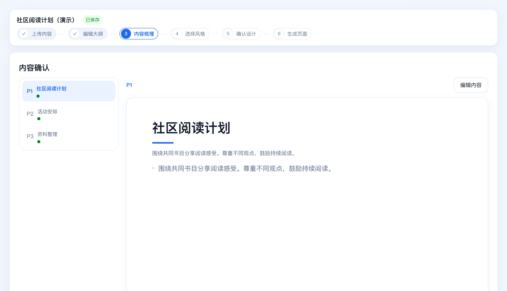

# SlideCraft 使用手册

上传文档制作演示页面，为已有 PPT 统一风格，把图片资料转成可编辑 PPT，或为演示稿补充逐页讲稿。本手册介绍安装、首次设置和日常操作。

适用版本：**v0.4.0**。项目下载：[GitHub · SlideCraft](https://github.com/dhk1413-del/slidecraft)。


**先选用途：** 首页选“文档导入生成”“PPT美化”或“图片转可编辑”；演讲稿从左侧“备注生成”进入。


首页也可以先选风格模板，再上传文件。截图为当前系统的功能区域；使用中性演示资料，不包含模型密钥。

<!-- pagebreak -->

## 1 用 AI 助手帮你安装


### 方式一 DeepSeek Harness 帮装

1. 打开 [DeepSeek 官方下载页](https://www.deepseek.com/zh/harness/)，选择对应系统的安装包，安装并登录。
2. 新建会话，选择本机工作目录，粘贴下方安装要求。
3. 按提示允许安装操作，完成后打开助手给出的工作台地址。

### 方式二 WorkBuddy 帮装

1. 从 [腾讯官方下载页](https://www.codebuddy.cn/downloads/) 获取 WorkBuddy，安装并登录。
2. 新建会话，粘贴同一段安装要求，按提示允许访问目录和执行命令。
3. 等待安装完成，打开工作台地址。

### 复制这段安装要求

```text
请帮我安装并启动 SlideCraft：
https://github.com/dhk1413-del/slidecraft
先阅读项目 README 和 AGENTS.md，按当前电脑系统安装。
macOS 使用本机终端；Windows 使用 PowerShell 原生安装。
准备 Git、Python 3.12、Node.js 22（至少 22.12）和 LibreOffice。
安装到用户目录下的 slidecraft，已有目录不要覆盖或删除。
安装前后端及 PPT 处理依赖，构建前端并启动服务。
先不配置模型密钥，用演示文本确认可以生成页面。
项目会自动安装图片转可编辑所需的重建工具（Harness、editppt、第三方 skill）；
装好后请提示我在 Harness 里登录一次，并确认图片转可编辑可用。
不要修改代码、提交或推送，不要覆盖已有项目与密钥。
最后告诉我安装位置、打开地址和下次启动方法。
```

**安装完成的标志：** 浏览器打开 `http://127.0.0.1:8641`，能看到 SlideCraft 首页。安装助手的登录与工作台中的模型设置分别完成。

<!-- pagebreak -->

## 2 手动安装

### macOS 准备软件

安装 [Python 3.12](https://www.python.org/downloads/)、[Node.js 22 系列最新版](https://nodejs.org/en/download/archive/v22)（至少 22.12）和 [LibreOffice](https://www.libreoffice.org/download/)，然后重新打开终端。LibreOffice 用于读取 PPT 文件。

首次使用 Git 时执行以下命令，按弹窗完成安装；已安装时跳过。

```bash
xcode-select --install
```

### macOS 下载并启动

```bash
cd ~
git clone https://github.com/dhk1413-del/slidecraft.git
cd slidecraft
npm --prefix web install
npm --prefix web run build
bash server/start-lan.sh
```

首次启动自动安装其余依赖，请等待“已就绪”。同时会**后台自动安装「图片转可编辑」所需的重建工具**（Harness CLI、editppt CLI 与第三方 skill）——不阻塞启动，装好后 `http://127.0.0.1:8641/api/editable-engines` 会变为可用；不需要可设 `DECKFORGE_SKIP_AGENT_INSTALL=1`，手动重试用 `make install-agent`，查看状态用 `make agent-status`。**Harness 需在本机登录一次**（安装器不代登录）。

### Windows 原生安装

安装 Windows 版 [Python 3.12](https://www.python.org/downloads/windows/)、[Node.js 22](https://nodejs.org/en/download/archive/v22)（至少 22.12）、[Git](https://git-scm.com/downloads/win) 和 [LibreOffice](https://www.libreoffice.org/download/)。安装 Python 时勾选“Add python.exe to PATH”，重新打开 **PowerShell**，依次执行：

```powershell
cd $HOME
git clone https://github.com/dhk1413-del/slidecraft.git
cd slidecraft
py -3.12 -m venv .venv
.\.venv\Scripts\python.exe -m pip install -r server/requirements.txt
npm.cmd --prefix server/pptx ci
npm.cmd --prefix web install
npm.cmd --prefix web run build
$env:PYTHONPATH = "$PWD\server"
.\.venv\Scripts\python.exe -m uvicorn app.main:app --host 127.0.0.1 --port 8641
```

两个系统都在浏览器打开 **http://127.0.0.1:8641**。Windows 运行期间保持 PowerShell 窗口打开，停止时按 **Ctrl+C**；不需要激活虚拟环境。

> **Windows 的「图片转可编辑」**：上面的 PowerShell 启动方式不经过 `server/run.sh`，所以不会自动装重建工具。首次可另开 **Git Bash**（装 Git 时自带）执行一次 `bash tools/install_agent.sh --install`，然后在 Harness 里登录一次即可。

<!-- pagebreak -->

## 3 首次打开与设置

**先体验：** 不填模型密钥也能进入全部页面、上传文档和梳理内容。点「生成」时会先提示配置模型；也可以选「先用本地演示」生成兜底排版页（费用 0，不代表真实设计）。「转可编辑」同样需要先就绪。

**启用 AI：** 左侧点“系统设置”。展开所需供应商，填写密钥及模型，先点“保存”，再点“连通性测试”。保存后直接使用，无需重启。


**按用途配置：** 内容梳理和备注使用文本模型；页面设计和 PPT 美化使用生图模型；图片识别使用视觉模型。图片转可编辑所需的重建工具（Harness、editppt CLI、第三方 skill）会在首次启动时自动安装，你只需**在 Harness 里登录一次**；之后可在「图片转可编辑」页确认引擎是否可用。

密钥只在本机设置页填写，不要写进说明书或分享截图。网络连接按实际环境选择；使用国内供应商时可选“直连”。


建议先用少量页面熟悉完整流程，再制作整套演示稿。

<!-- pagebreak -->

## 4 文档生成 上传与内容确认

### ① 上传内容

首页选“文档导入生成”，上传 TXT、MD、DOCX、PDF 或 PPTX，点“开始生成大纲”。也可在向导的“上传内容”使用“粘贴文本”。单个文件最大 **200MB**。

### ② 编辑大纲

等待大纲生成后，点击页面卡片修改标题和本页原文。可用“前移 / 后移”调整顺序，用“+ 内容页”“+ 过渡页”补充结构；不需要的页面可删除。完成后点 **“进入内容梳理”**。


### ③ 内容梳理

逐页核对标题、正文和要点。点“编辑内容”修改，点“保存 / 重试保存”；显示“已保存”后，点 **“已人工核对，确认内容并继续”**。



数字、单位、年份及来源应与原稿一致；需要补充的信息先在内容步骤改好，再继续。

<!-- pagebreak -->

## 5 文档生成 预览与生成页面

### ④ 选择风格

点“查看”放大预览，点 **“选择此风格”** 选中模板，再点“继续：开始生成”。也可以进入“+ 风格构建”创建自己的风格。


### ⑤ 确认设计

点 **“生成前 N 页预览”**，先检查前几页的设计与文字。满意后点 **“确认设计，进入生成页面”**；需要调整时返回更换风格或修改内容。


### ⑥ 生成页面

点“生成参与页”完成整套页面。逐页检查，点图片可放大；“缩略总览”可查看整册。单页需调整时点“重新生成本页”，完成后重新核对。


结果会保存在项目中。**需要可编辑 PPT 时：** 切换到“按图片版重建”，选页并开始精细重建，完成后下载可编辑 PPTX。已生成的导出文件，也可从“我的项目”卡片下载入口取回。

<!-- pagebreak -->

## 6 PPT 美化

适合已有 PPTX 或 PDF，需要统一视觉风格的资料。

1. **上传文件：** 首页选“PPT美化”，选择文件，点“开始 PPT 美化”。
2. **页面确认：** 勾选要处理的页面；需要保留原稿中的图片素材时勾选对应选项，再点“开始梳理内容”。
3. **内容梳理：** 逐页检查、修改文字，点“确认内容，选择风格”。
4. **选择风格：** 选中目标模板，点“生成前 N 页预览”。
5. **生成结果：** 点“对比原稿”检查效果；满意后点“确认预览，生成全部所选页面”，完成后点 **“下载图片集 PPT”**。
6. **转可编辑：** 需要修改页内文字和图形时，点“下一步：转可编辑”，启动精细重建；完成后点“下载可编辑版 PPT”。


**调整单页：** 点“✦ 优化本页”，填写修改要求并确认。点“查看历史版本”，可以先预览，再点“恢复此版本”。

“保留原页图片素材”用于保留原稿中的图片；仍应对照原稿检查最终文字、图片位置和完整性。

**使用条件：** 实际换风格需要生图模型。未配置时可能显示“已用原图”，此时预览仍是原稿副本。本手册的美化截图展示该真实状态。

<!-- pagebreak -->

## 7 图片转可编辑

适合图片、PDF 或整页图片式 PPT，需要修改页内文字、图片和图形的情况。

1. **上传内容：** 首页选“图片转可编辑”，上传 PDF、PPTX 或 PNG、JPG、WEBP 等图片。多张图片按上传顺序组成一册。
2. **页面确认：** 检查导入页面及顺序，点 **“确认页面，进入转换”**。
3. **转换结果：** 勾选需要处理的页，点 **“开始精细重建（N 页）”**，在确认框核对页数与范围后开始。
4. **等待并复核：** 查看各页状态。需要暂停时点“停止”；再次打开项目后，可点“继续转换”接着处理。
5. **下载文件：** 有成功结果后点 **“下载可编辑 PPTX”**，用 PowerPoint 打开并逐页检查文字、图形与背景。


转换耗时与页面复杂度有关，已完成页会保留。下载内容以界面显示的成功页面为准。

首次使用需准备重建工具和本机模型登录；按钮不可用时，按界面说明让安装助手检查。截图展示已导入、尚未开始转换的状态。

<!-- pagebreak -->

## 8 演讲备注

为已有 PPTX 配逐页讲稿，生成内容写入 PowerPoint 的备注栏。

1. **准备文件：** 左侧点“备注生成”，上传 PPTX，点“进入工作台”。
2. **选择方式：** 普通文字页选“DeepSeek 直接写备注”；图片为主的页面选“先识别图片，再写备注”，选择范围后点“开始识别”。
3. **生成讲稿：** 填写语气或使用场景，点“一键写完全部 N 页备注”。未完成时可继续剩余页面。
4. **逐页复核：** 点“下一步：逐页复核”，修改讲稿并保存。检查没有缺页或未保存内容，再点“复核完成，下一步”。
5. **导出下载：** 点 **“导出带备注的 PPT”**，保存新文件；也可使用页面中的下载链接。


写备注需要文本模型；识别图片还需要视觉模型。截图为已上传、尚未生成讲稿的状态。

原 PPT 的页面内容保持不变；原有备注会保留，新讲稿追加在后面。在 PowerPoint 中展开页面下方的“备注”区域，即可查看和修改。

<!-- pagebreak -->

## 9 日常操作与再次启动

### 继续项目和使用风格

- **继续工作：** 点“我的项目”，打开卡片，回到原流程继续。已有导出文件从卡片的“下载 / 下载最新”入口取回；下拉箭头可选择其他导出。
- **自建风格：** 点“风格选择 → + 风格构建”，上传参考 PPT、PDF 或图片，也可以用 **⌘V / Ctrl+V** 直接粘贴截图。检查解析结果后保存到风格库。
- **恢复单页：** 文档生成结果点对应的“版本”按钮回退；美化结果点“查看历史版本 → 恢复此版本”。回退后重新检查页面。

### 启动 停止与重启

使用安装助手告知的实际目录；手动安装默认如下。

**macOS：** 打开终端，执行：

```bash
cd ~/slidecraft
bash server/start-lan.sh
```

停止：`bash server/stop-daemon.sh`。重启：先停止，再启动。

**Windows：** 打开 PowerShell，执行：

```powershell
cd "$HOME\slidecraft"
$env:PYTHONPATH = "$PWD\server"
.\.venv\Scripts\python.exe -m uvicorn app.main:app --host 127.0.0.1 --port 8641
```

停止：在运行窗口按 **Ctrl+C**。重启：停止后重新执行启动命令。

启动后在浏览器打开 **http://127.0.0.1:8641**。

### 在自己的局域网共享

**macOS：** 先停止服务，再执行 `bash server/start-lan-public.sh`。

**Windows：** 先按 Ctrl+C 停止，把启动命令中的 `--host 127.0.0.1` 改为 `--host 0.0.0.0` 后运行；在系统提示中允许专用网络访问。

其他设备使用这台电脑的局域网 IP 和端口 **8641** 打开。仅在可信的家庭或个人局域网使用。
